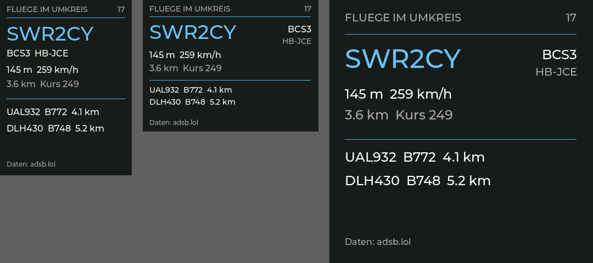

# AI Monitor Flights plugin

Aircraft flying near an [AI Monitor](https://github.com/tobymarks/esp32-ai-monitor)
ESP32 display: the nearest flight with callsign, aircraft type, registration,
altitude, speed, distance and heading, plus the next two. The companion app
fetches positions from [adsb.lol](https://adsb.lol) and sends the view to the
display over USB. No API key, ESP32 Wi-Fi connection or firmware reflash is
needed.



`flights.aimplugin` is a declarative archive containing only `plugin.json`. It
runs no third-party code on the computer or ESP32.

## Requirements

A companion app with plugin format 3 (display locations and list selection)
and firmware reporting `sceneProtocol: 1`. Older companions report that the
package needs a newer AI Monitor app.

## Install

1. In **Display**, set the location of the connected display.
2. In **Plugins**, choose `flights.aimplugin` or paste its direct HTTPS URL,
   choose **Inspect**, review the details, then **Install**.
3. In **Display**, add **Flights** to a window.
4. Optionally change the radius in **Plugins**. It is given in nautical miles
   because that is the unit the data source expects: 15 NM is about 28 km.
   The maximum is 40 NM; in dense airspace a large radius can exceed the
   64 KiB response limit and show a data error.

The view refreshes every 20 seconds while it is assigned to a window. It lists
airborne aircraft that report a callsign and move faster than 40 knots, nearest
first; the number in the header counts all of them. With Intelligent switching
the display changes to Flights when the sky was empty and a flight comes into
range. Near an airport, where something is always in range, that never fires.

German and English text and dark and light layouts are included. Firmware
with scene protocol 2 shows German umlauts; for older firmware the companion
writes `FLUEGE` instead of `FLÜGE`.

## Data source and trust

The companion requests `https://api.adsb.lol/v2/point/<lat>/<lon>/<radius>`
while the view is assigned. The request contains the display's coordinates
with three decimals and the radius. The companion states before installation
that the location is sent to that origin.

Flight data comes from adsb.lol and its feeders under the
[ODbL 1.0](https://opendatacommons.org/licenses/odbl/1-0/); the view shows
"Data: adsb.lol". The service has no key today, limits requests dynamically
and has announced that an API key for feeders may be required later. Routes
and airline names are not part of this data and not shown yet.

Packages are unsigned; the companion displays a SHA-256 checksum during
inspection and checks it again at installation.

## Build and validate

The six scenes share one structure and are generated:

```sh
python3 scripts/build_manifest.py   # writes plugin.json
python3 scripts/package.py          # writes flights.aimplugin
python3 scripts/package.py --check
```

`fixture.json` is a recorded response near Frankfurt, `fixture-empty.json` an
empty sky. With an AI Monitor checkout next to this repository:

```sh
cargo run --quiet --locked --manifest-path ../esp32-ai-monitor/companion-windows/Cargo.toml \
  -p aimonitor-plugin-host -- render flights.aimplugin - all fixture.json --locale=de \
  '--location={"name":"Frankfurt","latitude":50.03,"longitude":8.57}'
```

Omit the fixture path to request live data for the given location.

## License

Licensed under the [MIT License](LICENSE). `scripts/package.py` follows the
packer of the [Weather plugin](https://github.com/dlahmapollon/esp32-ai-monitor-weather-plugin).
